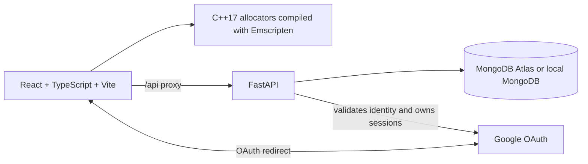

# HeapScope

[](https://github.com/shubham-parmar17/heapscope/actions/workflows/ci.yml)

HeapScope is an interactive C++17 memory allocator lab. It implements arena and fixed-size pool allocators,
STL and `std::pmr` adapters, and custom `UniquePtr`, `SharedPtr`, and `WeakPtr` types. Its React/TypeScript
visualizer runs the same C++ allocator code compiled to WebAssembly, while a FastAPI and MongoDB backend
supports Google sign-in and saved benchmark runs.

The project includes 47 GoogleTest cases under AddressSanitizer and UndefinedBehaviorSanitizer, a native
benchmark, WebAssembly smoke checks, OAuth flow tests, and a frontend production build.

[CI workflow](.github/workflows/ci.yml)

## Quick start

1. Install the prerequisites listed below and configure `backend/.env` and `frontend/.env` as described in [Configure environment](#configure-environment).
2. Start the backend in one terminal by following [Start the backend](#start-the-backend).
3. Start the frontend in a second terminal by following [Start the frontend](#start-the-frontend).
4. Open [http://localhost:3000](http://localhost:3000). Google sign-in is optional; allocator demos run without signing in.

## Layout

```
cpp/
├── CMakeLists.txt                  header-only INTERFACE lib · tests (ASan/UBSan) · bench (-O2)
├── include/alloclab/
│   ├── arena.hpp                   bump allocator: allocate(size, align), reset(), create<T>, move-only
│   ├── pool.hpp                    fixed blocks, intrusive free list, O(1), free_list_indices(), largest_free_run()
│   ├── stats.hpp                   AllocStats: used/peak/live/total/failed/padding/free-list/largest-free
│   ├── pool_adapter.hpp            PoolAdapter<T> → std::vector / list / map on the pool (heap fallback)
│   ├── pmr_adapter.hpp             ArenaResource / FreeListResource → std::pmr::memory_resource
│   ├── unique_ptr.hpp              UniquePtr<T, Deleter>: one word, move-only
│   ├── shared_ptr.hpp              SharedPtr<T> + WeakPtr<T>: two atomic counts, CAS lock(), copy-and-swap
│   └── bench.hpp                   3 workloads shared by native bench and the browser
├── tests/                          47 GoogleTest cases
├── bench/bench_main.cpp            native results table
└── wasm/                           bindings.cpp (embind) · build_wasm.sh · smoke.mjs
frontend/
├── index.html · vite.config.ts · tsconfig.json
├── public/wasm/alloclab.{mjs,wasm} built by cpp/wasm/build_wasm.sh
└── src/
    ├── wasm/loadAllocLab.ts        typed runtime loader, HEAPU8 access
    ├── lab/arenaModel.ts · arenaRenderer.ts · poolModel.ts · poolRenderer.ts
    ├── views/ArenaView.tsx · PoolView.tsx · FreeListView.tsx · CompareView.tsx
    ├── components/OpLog.tsx · HexDump.tsx · AccountControl.tsx
    ├── hooks/useLabKeys.ts (space = step, r = reset) · useTheme.ts (dark/light via CSS variables)
    └── styles.css                  the whole design system, no framework
backend/                            FastAPI: optional Google OAuth sign-in, MongoDB sessions
.github/workflows/ci.yml            tests + bench + wasm smoke + frontend typecheck/build
```

## Architecture



Allocator demos and comparisons run in the browser through WebAssembly. The API stores user sessions and
saved runs in MongoDB. Google OAuth credentials stay on the backend.

## Run locally

### Prerequisites

- C++17 compiler, CMake, and GoogleTest for native tests and benchmarks.
- Node.js 20 and Yarn 1 for the frontend.
- Python 3.12 or newer and a reachable MongoDB instance for the backend.
- Emscripten only if rebuilding WebAssembly; the repository includes the compiled bundle.

### Configure environment

```bash
cp backend/.env.example backend/.env
cp frontend/.env.example frontend/.env
```

In `backend/.env`, set `MONGO_URL` to your local MongoDB or Atlas connection string and keep
`DB_NAME=test_database`. To enable sign-in, fill in `GOOGLE_CLIENT_ID` and `GOOGLE_CLIENT_SECRET` for a
Google OAuth **Web application** client. Keep the secret in `backend/.env` only. Set the authorized redirect
URI in Google Cloud to exactly `http://localhost:8000/api/auth/google/callback`; the authorized JavaScript
origin is `http://localhost:3000`. The frontend example uses `REACT_APP_BACKEND_URL=http://localhost:8000`.

### Start the backend

```bash
cd backend
python3 -m venv .venv
source .venv/bin/activate
python -m pip install -r requirements.txt
python -m uvicorn server:app --port 8000
```

Leave this terminal open while using the app.

### Start the frontend

In a second terminal:

```bash
cd frontend
yarn install --frozen-lockfile
yarn start
```

Open [http://localhost:3000](http://localhost:3000). Sign in, run workloads from **Compare**, and save a run
to verify the end-to-end MongoDB path. The API health route is [http://localhost:8000/api/](http://localhost:8000/api/).

For local HTTP development, the example sets `COOKIE_SECURE=false`; production deployments must use HTTPS,
secure cookies, and deployment-specific origins and callback URLs. Never commit `.env` files.

## Checks

```bash
# Native C++ tests (ASan + UBSan) and benchmark
cmake -S cpp -B cpp/build -DCMAKE_BUILD_TYPE=Debug
cmake --build cpp/build -j
ctest --test-dir cpp/build --output-on-failure

# WebAssembly build and smoke check (requires an activated Emscripten SDK)
source /path/to/emsdk/emsdk_env.sh
cpp/wasm/build_wasm.sh
node cpp/wasm/smoke.mjs

# Frontend typecheck and production build
cd frontend
yarn typecheck
yarn build

# Deterministic Google OAuth flow tests
cd ../backend
.venv/bin/python -m pytest -o addopts='' tests/test_google_oauth_flow.py -q
```

The backend's database integration tests need a reachable MongoDB configured in `backend/.env`. CI runs the
OAuth flow tests without requiring Atlas credentials.

To run the native benchmark after building:

```bash
./cpp/build/alloclab_bench 2000000
```

The project currently has no hosted demo URL.

Native benchmarks do one warm-up and seven measured runs per cell. The table printed by `alloclab_bench`
reports the median, run-to-run range, compiler, and platform. Browser comparison uses three full-size
samples per cell and reports the median; its timer has roughly 0.1 ms resolution, so use native results for
fine-grained comparisons. Results are relative to their runtime: WebAssembly `new/delete` is Emscripten's
allocator, not the system allocator.

## Historical benchmark snapshot (single run, Linux aarch64, n = 2,000,000)

| workload | allocator | ms | ns/op | resets |
|---|---|---:|---:|---:|
| small-allocs (32 B) | new/delete | 75.05 | 18.76 | 0 |
| small-allocs (32 B) | arena | 8.68 | 2.17 | 0 |
| small-allocs (32 B) | pool | 10.87 | 2.72 | 0 |
| mixed-sizes (16–256 B) | new/delete | 107.66 | 26.92 | 0 |
| mixed-sizes (16–256 B) | arena | 11.15 | 2.79 | 0 |
| mixed-sizes (16–256 B) | pool | 25.14 | 6.28 | 0 |
| churn (window 1024) | new/delete | 22.29 | 11.15 | 0 |
| churn (window 1024) | arena | 7.19 | 3.60 | 4 |
| churn (window 1024) | pool | 6.70 | 3.35 | 0 |

The **compare** tab in the browser runs the same workloads in wasm and has a *copy markdown* button;
note that inside wasm "new/delete" is Emscripten's malloc, and browser timers are coarsened to ~0.1 ms.

## Visualizer

- **arena** — one memory bar at true proportional width: blocks, hatched alignment padding, hex start
  addresses, a sliding bump pointer; click a block for a hexdump read straight from wasm linear memory.
- **pool** — grid of fixed blocks; the free list is drawn as an arrow chain head-first; alloc pops the head,
  free pushes it, each with a 150 ms flash. The hexdump of a free block shows the `next` pointer bytes.
- **free list** — variable-size memory blocks with visible 16 B headers, first-fit splitting, address-ordered
  free-list order, and a scripted split/coalesce sequence that can be scrubbed operation by operation.
- **compare** — live timing bars while each allocator runs, then the results table.
- **pointers** — runs the real `SharedPtr`/`WeakPtr` through a scripted lifecycle in wasm and prints the control-block
  counts after every statement, plus the strong-cycle leak next to the weak back-edge fix.
- **pool extras** — `walk free list` hops through the list one node at a time, decoding the little-endian `next`
  pointer from the block's first 4 bytes; the *largest free run* stat carries a sparkline over the operation history.
- **saved runs** — signed-in users can save a benchmark run (with browser/platform/cores/memory) and compare any saved
  run against the current one as an extra ns/op column.
- **operation log** — `alloc(48, align 16) -> 0x00011860`, clickable, dimmed past the scrub cursor.
- Controls: allocate / free / reset / queue workload / step / run / history scrubber; `space` = step,
  `r` = reset; dark & light themes; respects `prefers-reduced-motion`; works at 1280 px and tablet width.

## Design notes

- Arena has **no per-block headers** — the visualizer records block metadata in the embind handle, not in the allocator.
- Pool stores the free-list `next` pointer **inside** free blocks (intrusive) → zero overhead; block size is rounded
  up to hold a pointer and keep alignment.
- Stats are a plain struct updated inline (no virtuals). Scrubbing = reset + replay, because both allocators are deterministic.
- `SharedPtr`: relaxed increment, acq-rel decrement; `UniquePtr`: `[[no_unique_address]]` deleter → `sizeof == sizeof(T*)`.
- Tests run under ASan + UBSan; the benchmark never does.

## 60-second pitch

> I built two allocators in C++17 and made them visible. The arena is a bump pointer: allocation is "align
> the cursor and add", freeing is a single reset — about 2 ns per op versus 19 for `new`. The pool hands
> out fixed blocks and keeps its free list inside the free blocks themselves, so there's no header overhead
> and alloc/free are O(1) pops and pushes. I wrapped the pool in an STL allocator so `std::vector` and
> `std::map` run on it, wrote my own `unique_ptr` and an atomic-ref-counted `shared_ptr`, and tested everything
> with GoogleTest under AddressSanitizer. Then I compiled the same headers to WebAssembly with embind, so the
> browser UI drives the real allocator: you can watch the bump pointer move, see alignment padding as hatched
> gaps, click a block and read its bytes out of wasm memory, watch the pool's free list zig-zag after frees,
> and race all three against `malloc` live.
